<picture><source media="(prefers-color-scheme: dark)" srcset="assets/dark/header.svg"></picture>

<a href="https://www.linkedin.com/in/niwinkumar/"><picture><source media="(prefers-color-scheme: dark)" srcset="assets/dark/link-linkedin.svg"></picture></a>
<a href="mailto:niwinkumar77@gmail.com"><picture><source media="(prefers-color-scheme: dark)" srcset="assets/dark/link-email.svg"></picture></a>
<a href="https://x.com/iamniwin"><picture><source media="(prefers-color-scheme: dark)" srcset="assets/dark/link-x.svg"></picture></a>

<picture><source media="(prefers-color-scheme: dark)" srcset="assets/dark/s-building.svg"></picture>

<a href="https://github.com/NiwinKumar/willow"><picture><source media="(prefers-color-scheme: dark)" srcset="assets/dark/card-willow.svg"></picture></a>
<picture><source media="(prefers-color-scheme: dark)" srcset="assets/dark/card-mcp.svg"></picture>

<picture><source media="(prefers-color-scheme: dark)" srcset="assets/dark/s-work.svg"></picture>

<a href="https://github.com/NiwinKumar/neuromancer"><picture><source media="(prefers-color-scheme: dark)" srcset="assets/dark/work-neuromancer.svg"></picture></a> 

<picture><source media="(prefers-color-scheme: dark)" srcset="assets/dark/s-toolkit.svg"></picture>

<picture><source media="(prefers-color-scheme: dark)" srcset="assets/dark/toolkit.svg"></picture>

<picture><source media="(prefers-color-scheme: dark)" srcset="assets/dark/s-activity.svg"></picture>

<picture><source media="(prefers-color-scheme: dark)" srcset="assets/dark/stats.svg"></picture>

<picture><source media="(prefers-color-scheme: dark)" srcset="assets/dark/footer.svg"></picture>
