<picture><source media="(prefers-color-scheme: dark)" srcset="assets/dark/hero.svg"></picture>

<a href="https://niww.in">niww.in</a> &nbsp;·&nbsp;
<a href="https://www.linkedin.com/in/niwinkumar/">LinkedIn</a> &nbsp;·&nbsp;
<a href="https://x.com/iamniwin">X</a> &nbsp;·&nbsp;
<a href="mailto:niwinkumar77@gmail.com">niwinkumar77@gmail.com</a>

<picture><source media="(prefers-color-scheme: dark)" srcset="assets/dark/stats.svg"></picture>

<picture><source media="(prefers-color-scheme: dark)" srcset="assets/dark/head-work.svg">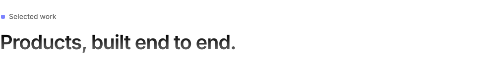</picture>

<a href="https://github.com/NiwinKumar/willow"><picture><source media="(prefers-color-scheme: dark)" srcset="assets/dark/willow.svg">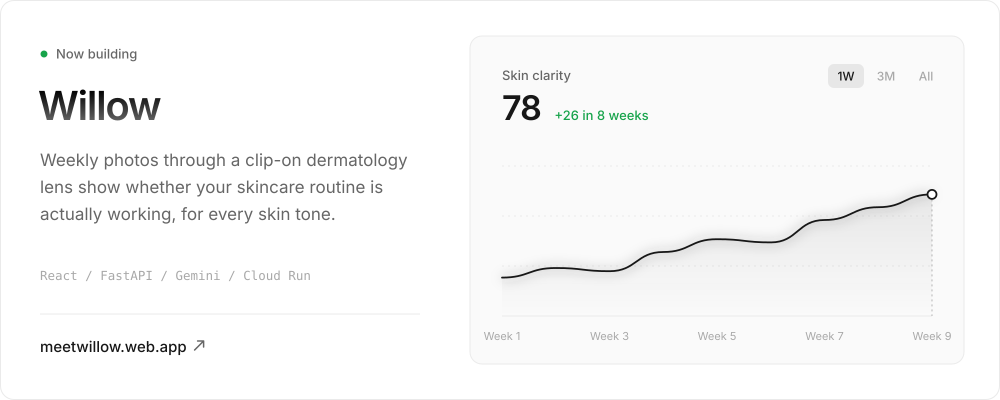</picture></a>

<a href="https://github.com/NiwinKumar/neuromancer"><picture><source media="(prefers-color-scheme: dark)" srcset="assets/dark/neuromancer.svg">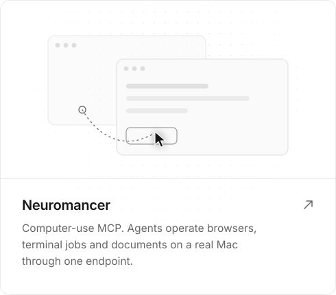</picture></a>
<picture><source media="(prefers-color-scheme: dark)" srcset="assets/dark/sitemcp.svg">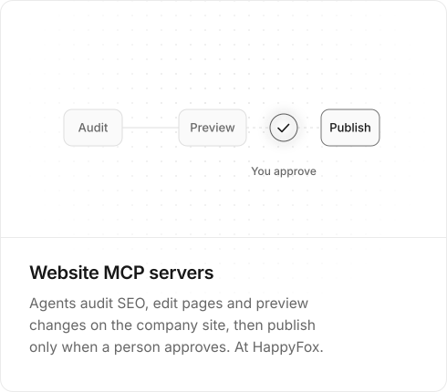</picture>

<picture><source media="(prefers-color-scheme: dark)" srcset="assets/dark/mentor.svg">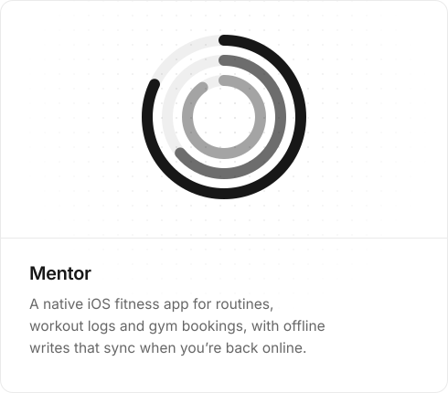</picture>
<picture><source media="(prefers-color-scheme: dark)" srcset="assets/dark/integrations.svg"></picture>

<picture><source media="(prefers-color-scheme: dark)" srcset="assets/dark/head-exp.svg"></picture>

<picture><source media="(prefers-color-scheme: dark)" srcset="assets/dark/experience.svg">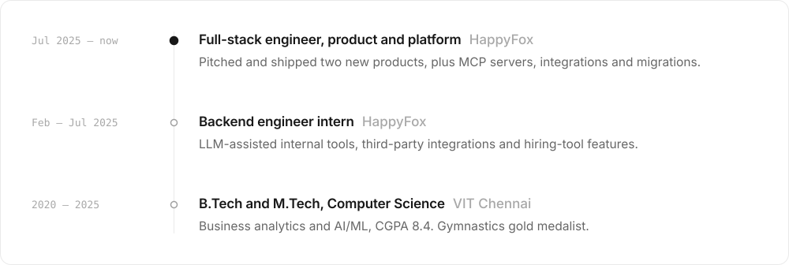</picture>

<picture><source media="(prefers-color-scheme: dark)" srcset="assets/dark/head-stack.svg">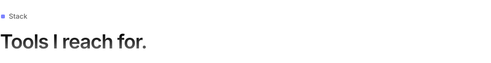</picture>

<picture><source media="(prefers-color-scheme: dark)" srcset="assets/dark/stack.svg">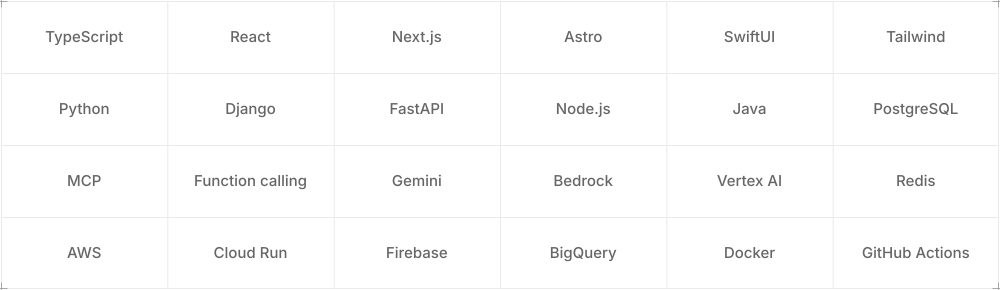</picture>

<picture><source media="(prefers-color-scheme: dark)" srcset="assets/dark/head-activity.svg">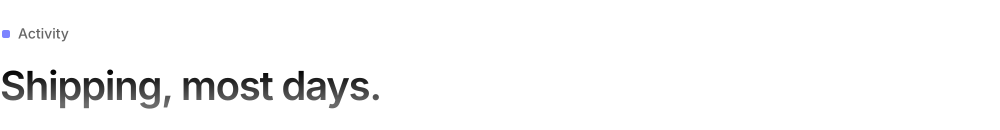</picture>

<picture><source media="(prefers-color-scheme: dark)" srcset="assets/dark/activity.svg">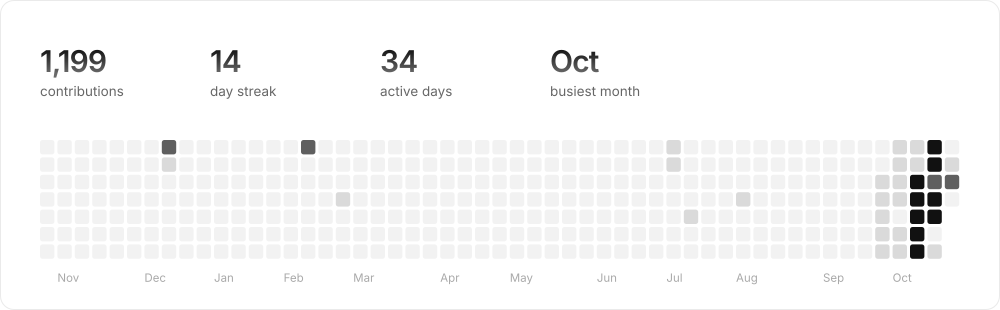</picture>

<a href="mailto:niwinkumar77@gmail.com"><picture><source media="(prefers-color-scheme: dark)" srcset="assets/dark/cta.svg">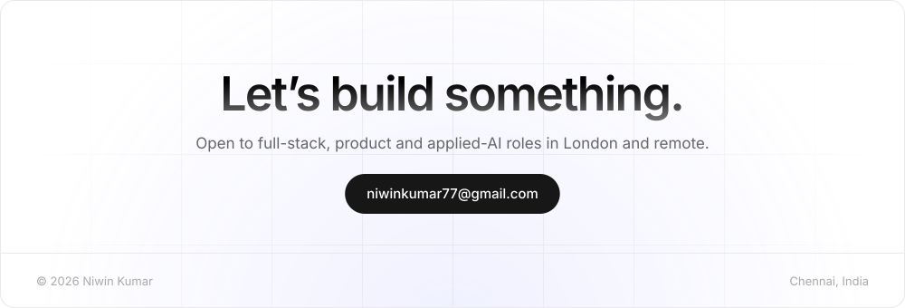</picture></a>
